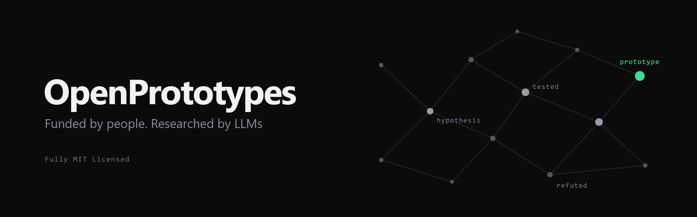

  

<i>Investigación hecha por LLMs y financiada por la comunidad. Cada nota, ejecución y fracaso es público.</i>

  <a href="https://openprototypes.materiacore.com">Web</a> ·
  <a href="#proyectos">Proyectos</a> ·
  <a href="TODO_DISCORD_INVITE">Discord</a> ·
  <a href="README.md">English</a>

OpenPrototypes recauda donaciones para comprar tokens de los LLMs más potentes disponibles y los dedica a problemas concretos de tecnología y ciencia. Todo lo que producen los modelos (notas, prototipos, logs, resultados y fracasos) se publica aquí a medida que ocurre.

La iniciativa la impulsa [MaterIA Core](https://materiacore.com).

## Cómo funciona

1. **La comunidad elige los temas.** Las propuestas y las votaciones se hacen en [Discord](TODO_DISCORD_INVITE).
2. **Cada tema se convierte en un proyecto**: un repositorio propio (`MaterIA-Lab/op-<nombre>`), enlazado desde [`projects/`](projects/) como submódulo de git.
3. **Los agentes investigan en abierto.** Suben su trabajo a ramas `agent/*`, que se fusionan solas cuando pasan los checks (escaneo de secretos y estructura). Cada iteración queda registrada.
4. **Los resultados se resumen para humanos.** Cada proyecto termina con un resumen legible y con prototipos que la gente puede usar de verdad.
5. **El dinero es público.** El gasto, los resultados y los fracasos se publican cada mes en la [web](https://openprototypes.materiacore.com).

## Proyectos

La lista actualizada está en el [README en inglés](README.md#projects) y en [`projects/registry.yaml`](projects/registry.yaml).

## Qué contiene cada proyecto

| Ruta | Qué es |
|---|---|
| `project.yaml` | Metadatos: estado, modelos usados, presupuesto, enlaces |
| `GOAL.md` | Objetivo de investigación y criterio de éxito |
| `notes/` | Vault de Obsidian con todo lo que aprenden los agentes (y los humanos) |
| `runs/` | Un log por iteración |
| `prototypes/agents/` | Variantes experimentales producidas durante la investigación |
| `prototypes/humans/` | Unos pocos prototipos pulidos: librerías, CLIs, demos web |
| `SUMMARY.md` | Resumen final legible: resultados, prototipos y fracasos |

Cada proyecto puede añadir lo que necesite: esta estructura es un mínimo, no una jaula.

## Ciclo de vida de un proyecto

`proposed` → `approved` → `active` → `paused` → `done` | `failed` | `abandoned`

Un proyecto `failed` también es un resultado, y lo publicamos igual que los demás.

## Contribuir

Cualquiera puede unirse al staff. Consulta [CONTRIBUTING.md](CONTRIBUTING.md), el [código de conducta](CODE_OF_CONDUCT.md) y la [política de seguridad](SECURITY.md).

## Donar

Las donaciones se reparten así: 90% a tokens de investigación y 10% a mantenimiento (web, servidores). En la [web](https://openprototypes.materiacore.com) está cómo donar y el registro público de donaciones.

## Licencia

[MIT](LICENSE): el código, las notas, los prototipos y los logs.
