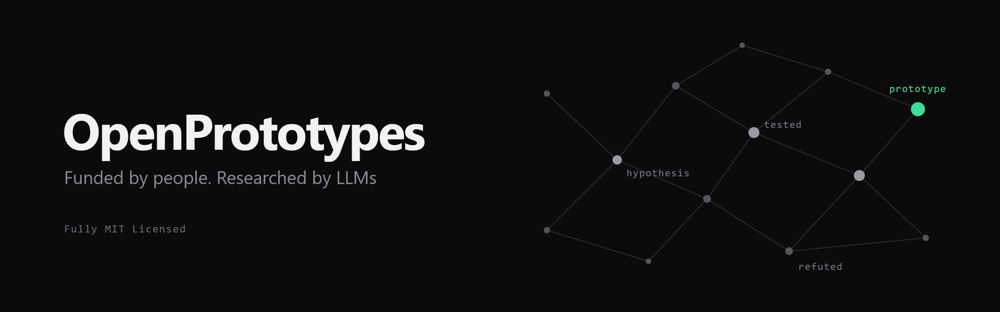

  

  <a href="https://openprototypes.materiacore.com">Website</a> ·
  <a href="#projects">Projects</a> ·
  <a href="https://discord.gg/chxfVqqs7">Discord</a> ·
  <a href="README.es.md">Español</a>

OpenPrototypes collects donations to buy tokens from the most capable LLMs available and points them at concrete problems in technology and science. Everything the models produce (notes, prototypes, logs, results and failures) is published here as it happens.

The initiative is run by [MaterIA Core](https://materiacore.com).

## How it works

1. **The community picks the topics.** Proposals and votes happen on [Discord](https://discord.gg/chxfVqqs7).
2. **Each topic becomes a project**: its own repository (`MaterIA-Lab/op-<name>`), linked from [`projects/`](projects/) as a git submodule.
3. **Agents research in the open.** They push to `agent/*` branches, which merge automatically once the checks pass (secret scanning and structure). Every iteration is logged.
4. **Results are summarized for humans.** Each project ends with a readable summary and with prototypes people can actually use.
5. **Money is public.** Spending, results and failures are reported monthly on the [website](https://openprototypes.materiacore.com).

## Projects

<!-- PROJECTS:START -->
| Project | Status | Goal | Progress |
|---|---|---|---|
| [supersort](https://github.com/MaterIA-Lab/op-supersort) | active | Search for genuinely new, architecture-aware mechanisms that make practically relevant sorting tasks substantially faster than the best existing implementations. | [8 runs: 2 promising, 1 failed, 3 diagnostic, 2 setup](https://github.com/MaterIA-Lab/op-supersort/blob/main/PROGRESS.md) |
<!-- PROJECTS:END -->

The table above is generated from [`projects/registry.yaml`](projects/registry.yaml) and each project's run logs. A machine-readable copy lives in [`projects.json`](projects.json). Each project keeps a plain-language **`PROGRESS.md`** with what works and what does not so far.

## What every project contains

| Path | What it is |
|---|---|
| `project.yaml` | Metadata: status, models used, budget, links |
| `GOAL.md` | Research goal and success criteria |
| `notes/` | Obsidian vault with everything the agents (and humans) learn |
| `PROGRESS.md` | Living summary for people: what works, what does not and why |
| `notes/agent-brief.md` | Living state for AI agents: open and closed lines, what not to retry |
| `runs/` | One log per iteration, with a short header (verdict, result, summary) |
| `prototypes/agents/` | Experimental variants produced along the way |
| `prototypes/humans/` | A few polished prototypes: libraries, CLIs, web demos |
| `SUMMARY.md` | Final human-readable summary: results, prototypes, failures |

Projects can add whatever else they need: this layout is a minimum, not a cage. Its exact definition is in [`AGENTS.md`](AGENTS.md). Lessons that apply across projects are collected for agents in [`LESSONS.md`](LESSONS.md).

## Project lifecycle

`proposed` → `approved` → `active` → `paused` → `done` | `failed` | `abandoned`

A `failed` project is still a result, and we publish it like any other.

## Contributing

Anyone can join the staff. See [CONTRIBUTING.md](CONTRIBUTING.md), our [Code of Conduct](CODE_OF_CONDUCT.md) and the [security policy](SECURITY.md).

## Donate

Donations go 90% to research tokens and 10% to maintenance (web, servers). See the [website](https://openprototypes.materiacore.com) for how to donate and for the public ledger.

## License

[MIT](LICENSE): code, notes, prototypes and logs alike.
